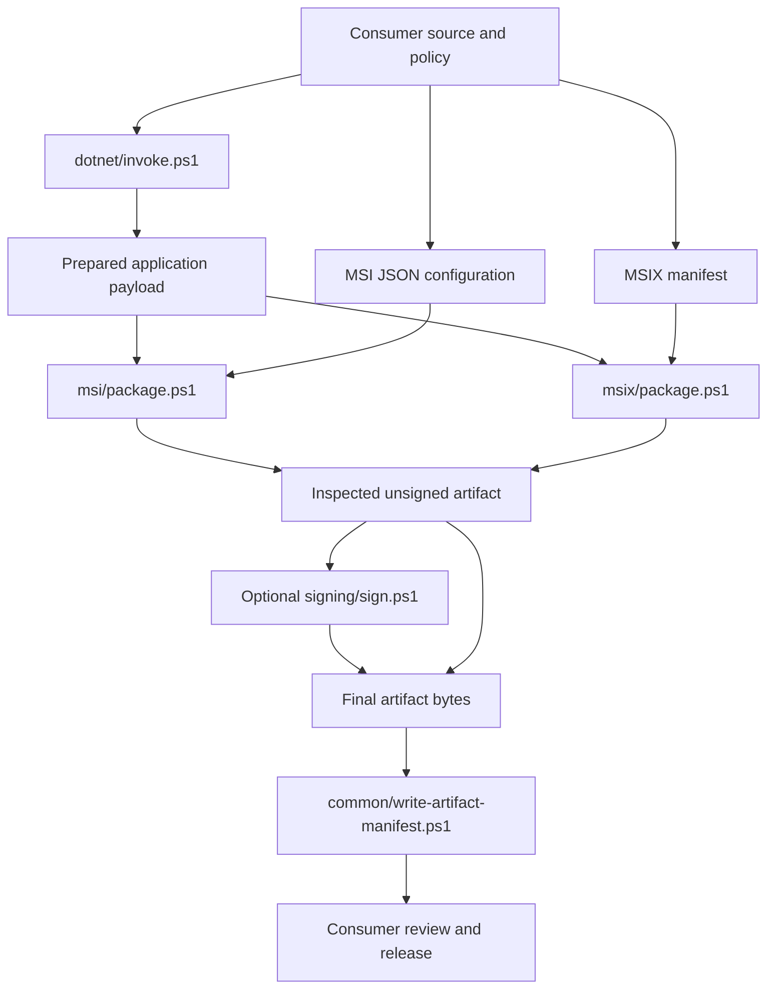

# winbuildtools architecture

winbuildtools provides reusable Windows packaging and explicit .NET build commands.
Consumers check out an exact Git revision and supply their own application inputs.
The tools validate those inputs, invoke installed platform tools and return paths
and metadata only after the requested operation succeeds.

This document describes implementation boundaries and maintenance constraints.
Use [README.md](README.md) for commands, [DEVELOPERS.md](DEVELOPERS.md) for public
parameters/results, and the [MSI guide](msi/README.md) for configuration and installer
behavior. Platform requirements and review responsibilities live in
[dependencies](docs/DEPENDENCIES.md).

## Ownership and data flow

The consuming application owns source, dependency/SDK selection, lock files,
product identity, approved payload, manifests, signing identity and release policy.
It initializes and deliberately updates the pinned checkout; packaging scripts do
not fetch tools or follow a branch head.

The .NET step is optional: packaging accepts an already prepared payload from any
build system. Signing changes bytes in place, so inspection hashes taken before it
are superseded. Generate final metadata after signing and verification. Metadata
records facts about bytes and caller-supplied source fields; it is not a signed
attestation or proof of application safety.

## Repository boundaries

| Area | Owns | Dependencies |
| --- | --- | --- |
| [msi/](msi/README.md) | Standalone MSI configuration, identities, cabinet/database authoring and inspection | Windows Installer COM/msi.dll, MakeCab, Expand; only files inside msi/ |
| [common/Paths.ps1](common/Paths.ps1) | Filesystem-provider resolution, link/overlap guards, payload enumeration | PowerShell and .NET filesystem APIs |
| [common/Tools.ps1](common/Tools.ps1) | Native process diagnostics and installed SDK discovery | Paths.ps1 and caller-installed tools |
| [common/Artifacts.ps1](common/Artifacts.ps1) | Final hash/signature JSON metadata | Paths.ps1 and Authenticode inspection |
| [msix/Msix.ps1](msix/Msix.ps1) | Manifest validation, staging and exact MSIX content inspection | Tools.ps1, MakeAppx and framework XML/crypto APIs |
| [signing/Signing.ps1](signing/Signing.ps1) | Existing certificate selection, signing and expected-signer verification | Tools.ps1, SignTool and certificate/Authenticode APIs |
| [dotnet/invoke.ps1](dotnet/invoke.ps1) | One explicit restore, build or publish with a consistent context | Tools.ps1 and the consumer's installed .NET SDK |
| [examples/consumer-package.ps1](examples/consumer-package.ps1) | Example adapter locating a pinned tool and product config | Consumer-owned deployment/msi.json and external/winbuildtools |
| [verify.ps1](verify.ps1), [tests/](tests/TestSupport.ps1), [msi/tests/](msi/tests/test-msi.ps1) | Synthetic regression checks and optional consumer/.NET integration | Installed platform tools; no external test framework |
| [.github/workflows/verify.yml](.github/workflows/verify.yml) | Manual hosted verification of a selected revision | Native Git and PowerShell on the hosted Windows runner |

The capitalized helper files define functions when dot-sourced. Public command
scripts validate/bind parameters, load helpers relative to `$PSScriptRoot`, invoke
one operation and emit structured results. The MSI engine deliberately duplicates
some path/tool primitives: importing `common/` would break copying `msi/` alone.
Do not add application-specific imports or references back into Agenda/ProcSight.

## Paths, output and failures

Filesystem paths resolve against PowerShell's current location through the provider
API, including destinations that do not exist yet. `.NET`'s process directory can
differ after `Set-Location`, so direct relative `.NET` path resolution is insufficient.
The consumer adapter resolves tool/config paths against its own script location;
payload/output arguments retain the caller's working-directory semantics.

Shared helpers reject reparse points in checked paths and existing ancestors.
Payload walkers inspect children before descending, rejecting links instead of
following them. MSI has its own root/descendant link and strict relative-name
validation; it does not use the shared ancestor guard. These checks are input
validation, not a filesystem sandbox or protection against concurrent mutation.
Consumers must keep build inputs stable and trusted while operations run.

Packaging and inspection outputs must be new directories outside the payload.
Publish destinations must be new and satisfy the source/artifact overlap checks
in [dotnet/invoke.ps1](dotnet/invoke.ps1). Manifest output uses `CreateNew` to avoid
overwriting existing metadata. Other preflight existence checks should not be
treated as atomic reservation of output paths.

Public commands set terminating error behavior. Native tools are passed argument
arrays and their exit codes are checked explicitly. Shared invocation saves full
child output when given a log path, prints concise host diagnostics and throws on
failure; child output is not returned as result data. Do not put secrets into
MSBuild properties or logged commands. The standalone MSI runner includes failed
tool output in its exception instead of depending on shared logging.

There is no global rollback. Failed output is retained for diagnosis and must not
be released or reused. MSI authoring removes its partial MSI after releasing COM
locks, but retains authoring scratch files. Signing failure can leave changed
artifact bytes. Development-key creation can leave a key if public export fails.
Temporary test/preflight trees are removed in `finally` after checking absolute
cleanup targets; native handles, COM objects, streams and certificates have explicit
ownership and cleanup.

## MSI pipeline

[package.ps1](msi/package.ps1) loads `Configuration`, `Identity`, `Payload`,
`Database`, `Authoring` and `Inspection` in that order. It validates inputs before
creating output, authors the MSI, checks its contents and only then writes
`inspection.json` and returns the artifact/hash/result object.

1. [Configuration.ps1](msi/Configuration.ps1) detects duplicate JSON keys before
   conversion, validates [config.schema.json](msi/config.schema.json), then checks
   semantic Windows path/name rules. Unknown fields and ambiguous names fail
   rather than being silently corrected.
2. [Payload.ps1](msi/Payload.ps1) walks files without descending through links,
   sorts normalized relative paths, checks approvals and required files, and
   returns file/component records. One cabinet is bounded to 10,000 files and
   2 GiB uncompressed; individual sizes must fit MSI's signed FileSize field.
3. [Identity.ps1](msi/Identity.ps1) and [Database.ps1](msi/Database.ps1) derive
   deterministic IDs from the permanent product namespace and normalized scope.
   Architecture scopes upgrade families; version scopes ProductCode; relative
   paths scope components. PackageCode is fresh per authoring. Do not change the
   hash, normalization or scopes without considering shipped installer ownership.
4. [Authoring.ps1](msi/Authoring.ps1) uses MakeCab with file IDs as cabinet member
   names, then authors standard MSI tables through parameterized COM records.
   File.Sequence follows cabinet order. Each file has a 64-bit component and file
   key path; short/long aliases and unversioned MSI file hashes have explicit rules.
5. Architecture-specific install/menu directories prevent independent families
   from owning the same files. Advertised shortcuts target the `Main` feature.
   Folder ownership/cleanup is limited to owned empty directories. Upgrade removal
   runs after InstallInitialize so it participates in the install transaction.
   There are no authored custom actions or application launch/termination hooks.
6. [Inspection.ps1](msi/Inspection.ps1) reads table snapshots, rejects forbidden
   tables, checks identities/mappings/folder ownership, extracts the embedded
   cabinet through bounded `msi.dll` interop, and compares file bytes by SHA-256.
   Database mappings alone do not prove cabinet contents.

For the native host architecture only, inspection also runs an explicit allowlist
of search/costing/validation actions against a disposable MSI copy. That copy has
new product, upgrade, package and component identities and temporary target paths.
Never substitute the install execute sequence for this allowlist. Foreign-architecture
packages receive table/cabinet checks without native costing. This preflight does
not establish install/upgrade/repair/uninstall acceptance or replace ICE validation.

## MSIX pipeline

[New-WbtMsix](msix/Msix.ps1) reads the separate caller manifest with DTD processing
prohibited and external XML resolution disabled. It rejects reserved container
metadata in the payload, copies inputs into a staging tree and invokes MakeAppx.
The consumer owns every identity, capability, extension and product-specific rule;
the tool does not generate or rewrite them.

`Test-WbtMsix`, also exposed by [inspect.ps1](msix/inspect.ps1), unpacks to a fresh
tree and compares identity fields, canonical manifest XML and every expected file
hash. A reverse file-set walk rejects unexpected payload entries, allowing only
the explicit generated metadata list in the implementation. Keep both directions
when changing this check. The package command writes its result/report only after
inspection succeeds. No resource bundles, encryption or Store upload packaging is
implemented here.

## Signing and trust

[Signing.ps1](signing/Signing.ps1) accepts one explicit CurrentUser/My thumbprint
or PFX. Before signing it checks validity, private-key presence, code-signing EKU
and, for MSIX, the subject against the publisher read from the actual artifact.
PFX validation uses ephemeral key loading; the certificate is disposed by its owner.

SignTool uses SHA-256 for file and optional RFC 3161 timestamp digests. Its `/sha1`
option selects a certificate thumbprint; it does not choose the file digest.
Secret-bearing signing arguments bypass the general logger. PFX passwords still
reach the child process; handling limits are described in [SECURITY.md](SECURITY.md).

After signing, the helper rereads the signature and checks the expected signer and
accepted status (`Valid` or `NotTrusted`). `-RequireTrusted` additionally requires
SignTool's host Authenticode policy to pass. Results describe the modified bytes;
no success object is emitted after failure. Content inspection and signature/trust
verification are separate checks.

[new-dev-certificate.ps1](signing/new-dev-certificate.ps1) explicitly creates a
non-exportable development key and public CER. Separately,
[trust-dev-certificate.ps1](signing/trust-dev-certificate.ps1) requires administrator
rights, checks the reviewed thumbprint and imports the public leaf into
LocalMachine/TrustedPeople. Both support ShouldProcess; neither operation belongs
in a build/pack pipeline. Trust deployment/removal remains consumer policy.

## .NET orchestration

[invoke.ps1](dotnet/invoke.ps1) accepts one existing project and keeps configuration,
runtime, scalar MSBuild properties and artifacts root explicit. It rejects reserved
context overrides and property separators that MSBuild could parse as extra values.
Complex project settings stay in consumer MSBuild files, which are executable build
inputs and must be trusted.

Restore requires an existing project lock, including an explicitly supplied custom
NuGetLockFilePath, and invokes locked mode with lock generation enabled. Build and
Publish always use `--no-restore`; they must reuse the matching restore context.
The helper does not discover lock policies for referenced/imported projects. Paths
are resolved before changing location to the project directory for SDK/global.json
selection, and the caller's location is restored in `finally`.

## Verification and maintenance

Run `./verify.ps1 -Integration` and `git diff --check` after changes. The runner
parses scripts, runs standalone MSI tests, shared/MSIX/signing/.NET guard tests,
and repository provenance/help/link/workflow checks. Integration additionally
restores, builds, publishes and executes a dependency-free managed fixture, then
clones a disposable consumer with a pinned submodule and builds its MSI.

The consumer clone exercises committed HEAD, not uncommitted tool edits. Other
tests run against the working tree. Expected negative cases print failure output;
the suite's final pass/failure status determines the result. Tests never install
products or create/use/trust signing keys. See [validation](docs/VALIDATION.md) for
coverage and acceptance limits.

Maintain these constraints when changing scripts:

- Keep public wrappers thin and structured results free of incidental output.
- Document purpose, inputs/results, side effects and helper loading at script level.
  Explain non-obvious sequencing, identity, security and cleanup rules beside code.
  Update comments whenever the corresponding behavior changes.
- Keep MSI standalone and add regression coverage for changed public contracts,
  identity rules, authoring tables or inspection checks.
- Preserve extraction history in [provenance.json](docs/provenance.json). `SHA256`
  tracks current files; `ExtractionSHA256` preserves the original value when a
  local modification is recorded. Never refresh hashes to conceal unexplained edits.
- Update this document when ownership, dependencies, data flow, output/failure
  semantics or verification boundaries change. Follow [AGENTS.md](AGENTS.md).
